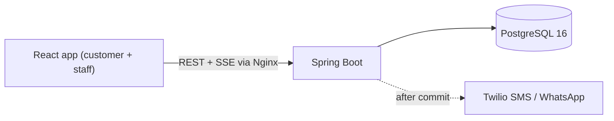
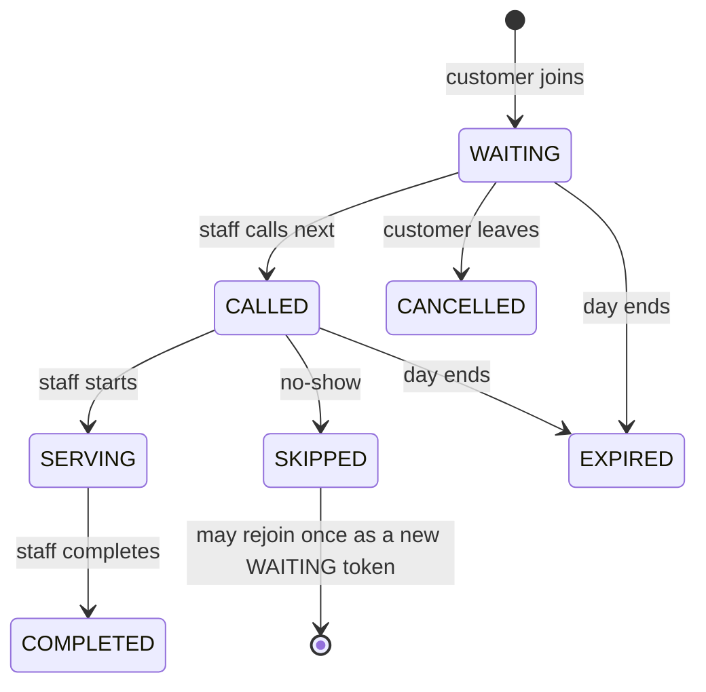
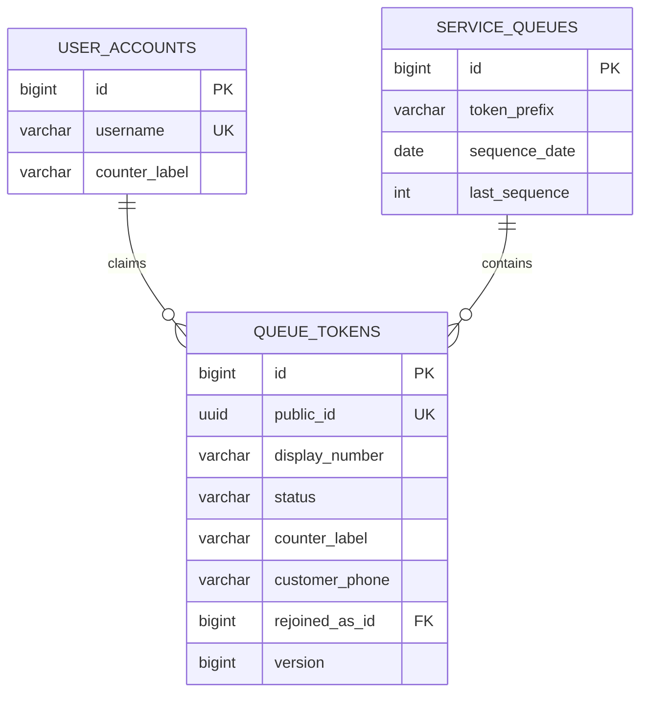

# LinePilot architecture



One backend, one database. Nginx serves the React build and proxies `/api`.

## Backend packages

| Package | What it holds |
|---|---|
| `controller` | HTTP endpoints. After a change commits, they push a fresh snapshot to live boards. |
| `service` | `QueueService` (all queue logic, transactional), `WaitTimeEstimator`, `QueueEventStream` (SSE), `DailyTokenExpiry`. |
| `notify` | "Your turn" messages: an event published on call-next, sent after commit by `TokenCalledListener`. |
| `security` | Staff sign-in (BCrypt, HTTP Basic), join rate limit, failed-login throttle. |
| `entity`, `repository`, `dto` | JPA entities with the token state rules, queries, API records. |

## Token lifecycle



The entity methods reject invalid moves. Staff-only moves also check that the token belongs to that staff member. Invalid moves return 409.

## Concurrency

**Call next.** Two staff pressing at once must get different customers:

```sql
SELECT * FROM queue_tokens
WHERE service_queue_id = :queueId AND status = 'WAITING'
ORDER BY joined_at, id
FOR UPDATE SKIP LOCKED
LIMIT 1;
```

`FOR UPDATE` holds the row until commit, and `SKIP LOCKED` lets the second transaction take the next row instead of waiting. If only one token is waiting, the second request gets 409. A partial unique index (`claimed_by_id` where status is CALLED or SERVING) stops one staff member holding two customers, even if two of their own requests race.

**Join.** The queue row is locked (`SELECT … FOR UPDATE`) while the daily counter goes up. The unique constraint on `(queue, date, number)` is the backstop.

**Cancel vs call.** `queue_tokens.version` (JPA `@Version`) makes the slower request fail with 409 instead of overwriting. The same check stops a no-show from rejoining twice.

## Live updates

Browsers open `GET /api/queues/{id}/events`. After every committed change, the controller sends a fresh snapshot to everyone watching that queue. The snapshot includes the average service time and the number of active staff, so each customer's browser works out its own position and wait without calling the server back. It only fetches its token again when the token drops off the board.

Subscribers live in memory, which is why LinePilot runs as a single instance.

## Wait estimate

`average of the last 10 service times (serving → completed) × ceil(people ahead ÷ active staff)`

People ahead means everyone being called or served plus everyone who joined earlier and is still waiting. Active staff are those holding a token or who finished a customer in this queue in the last 30 minutes. If no services have completed yet, the queue's default minutes are used. It ignores breaks and time of day.

## Daily housekeeping

`DailyTokenExpiry` runs just after local midnight (and once at startup, in case the server was down then). It marks WAITING and CALLED tokens from earlier days as EXPIRED and clears stored phone numbers. SERVING tokens are left for staff to complete.

## Abuse protection

- Joining (and rejoining) is limited to 5 per IP per 10 minutes.
- 5 wrong staff passwords from an IP block sign-in from that IP for 15 minutes.
- Behind Nginx the client IP comes from `X-Forwarded-For`, trusted only from internal proxy addresses.

## Database

Three tables, created by Flyway migrations in `backend/src/main/resources/db/migration`.



`queue_tokens` is both the live queue and the history. Finished rows stay for reporting and for the wait estimate. Every index serves a specific query: call-next (waiting rows only), history (newest first) and the wait estimate (completed rows only).

## Failures

| Situation | Response |
|---|---|
| Unknown queue or token | 404 |
| Closed queue, nobody waiting, invalid move, lost race | 409 |
| Invalid input (name, phone) | 400 with a per-field error map |
| Missing or wrong staff password | 401 |
| Too many joins or failed sign-ins | 429 |
| SMS provider down | Logged. The customer still sees the call on the board. |
