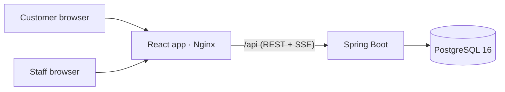
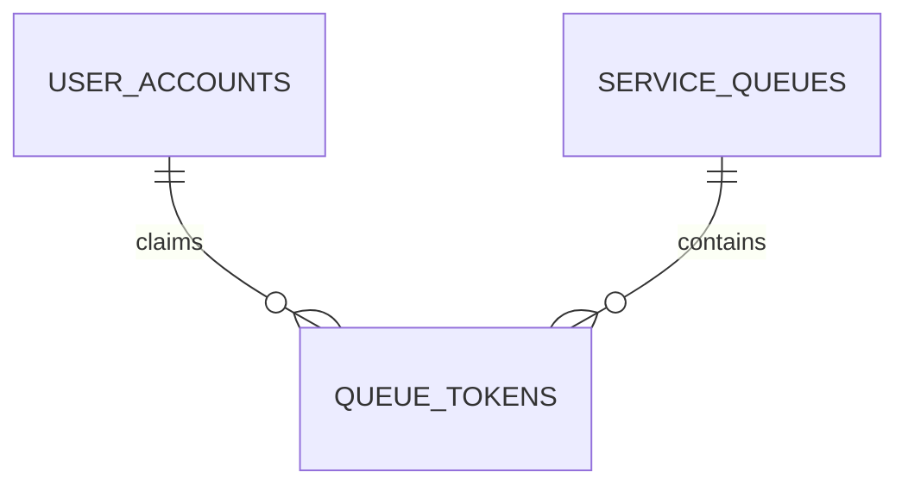
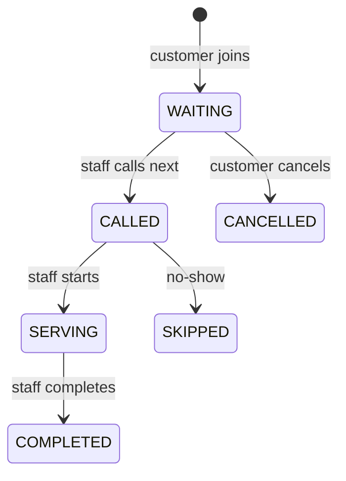

# LinePilot architecture



Nginx serves the React bundle and proxies API and SSE traffic to a single Spring Boot backend.

## Backend packages

| Package | Responsibility |
|---|---|
| `controller` | HTTP mapping, validation, and notifying live boards after a change commits |
| `dto` | API contracts; entities never leave the backend |
| `entity` | Table mappings and token state-transition rules |
| `repository` | JPA queries, pagination, and the locking query |
| `service` | `QueueService` (business logic), `WaitTimeEstimator`, `QueueEventStream` (SSE) |
| `security` | BCrypt, HTTP Basic, URL rules, CORS |
| `exception` | Consistent JSON errors (`ProblemDetail`) |
| `config` | Clock, OpenAPI, demo data |

## Data model



- `service_queues`: queue settings plus the daily token counter (`sequence_date`, `last_sequence`).
- `queue_tokens`: both the live queue and the history. Finished tokens stay for reporting and wait estimates.
- `user_accounts`: staff logins. Customers don't have accounts.

Key constraints:
- **Unique `(queue, date, sequence)`:** one token number per queue per day.
- **Unique `public_id` (UUID):** the customer's tracking handle.
- **Partial unique index on `claimed_by_id` for `CALLED`/`SERVING`:** one active token per staff member.
- **`version` column on `queue_tokens`:** a customer cancel and a staff call on the same token can't silently overwrite each other; the loser gets `409`.

## Joining a queue

`joinQueue` locks the queue row (`SELECT … FOR UPDATE`), resets the counter if the date changed, increments it, and inserts a `WAITING` token, all in one transaction. The unique constraint backs this up if any other code path ever skips the lock.

## Calling the next customer

```sql
SELECT * FROM queue_tokens
WHERE service_queue_id = :queueId AND status = 'WAITING'
ORDER BY joined_at, id
FOR UPDATE SKIP LOCKED
LIMIT 1;
```

`FOR UPDATE` locks the chosen row until commit. `SKIP LOCKED` makes a second staff member take the next row instead of waiting. With only one token waiting, one request wins and the other gets `409`. A partial index on `(service_queue_id, joined_at, id) WHERE status = 'WAITING'` keeps this fast.

## Token states



Entity methods reject invalid transitions and check that the staff member owns the token. The API turns an invalid transition into `409`.

## Live updates (SSE)

A client opens `GET /api/queues/{id}/events` and immediately receives a snapshot. After each write commits, the controller broadcasts a fresh snapshot, so clients never see a change that later rolls back. Emitters are stored in memory and removed on timeout or disconnect, and the browser's `EventSource` reconnects on its own. Because subscribers live in memory, only one backend instance is supported.

## Wait estimate

The estimate is the average of the last ten service durations (`serving_at` → `completed_at`), times the number of people ahead. If there's no history yet, the queue's default minutes are used instead.

## Security

- Staff passwords are BCrypt-hashed in `user_accounts`.
- `/api/staff/**` and `/api/auth/me` require login over HTTP Basic. Everything else is public: browsing, joining, tracking or cancelling by UUID, and SSE.
- CSRF is off because credentials go in the `Authorization` header, not a cookie. Use HTTPS outside localhost.

## Errors

| Case | Response |
|---|---|
| Unknown queue or token | 404 |
| Closed queue, empty queue, invalid transition, concurrent edit, constraint race | 409 |
| Validation failure | 400 with field errors |
| Missing or wrong staff credentials | 401 |
